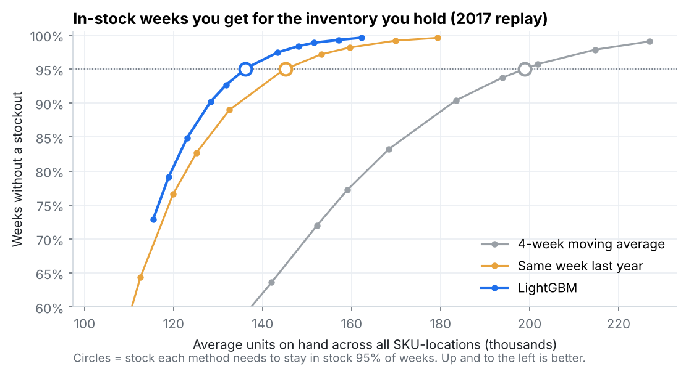
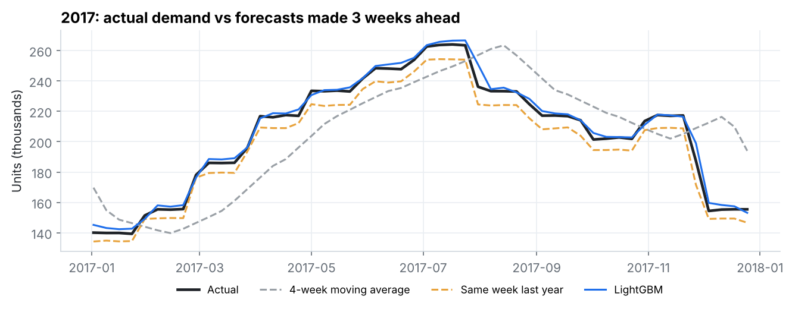
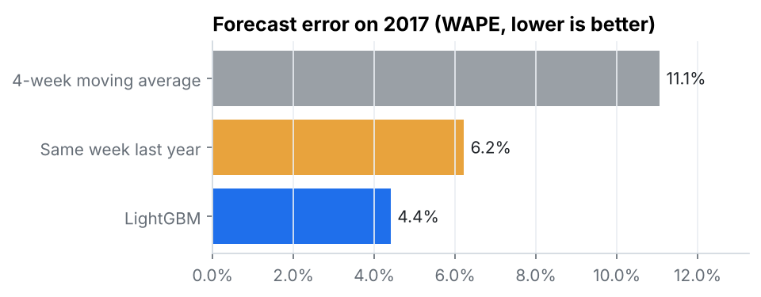
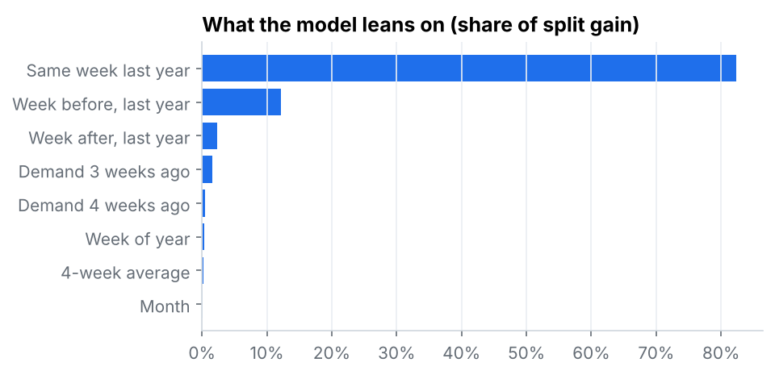

# Demand Forecasting & Safety Stock Optimization

**How much inventory does a better forecast actually save?** This project forecasts weekly demand for 500 SKU-locations, sets safety stock from each one's measured forecast error, and replays a full year of real demand to see what each forecast method costs in stock and stockouts.

`Python` `SQL (DuckDB)` `LightGBM` `pandas` `SciPy` `matplotlib`

---

## Result

To stay in stock in **95% of weeks** across all 500 SKU-locations in 2017:

| Forecast method | Forecast error (WAPE) | Avg. units on hand needed | vs. LightGBM |
|---|---|---|---|
| 4-week moving average | 11.1% | ~199,000 | LightGBM needs **32% less** |
| Same week last year | 6.2% | ~145,000 | LightGBM needs **6% less** |
| **LightGBM** | **4.4%** | **~136,000** | — |



**What this means for a planner**
1. **Drop the moving average.** It lags every seasonal turn. It over-forecast the late-2016 decline by 7%, then lagged the 2017 ramp. It needed 37–46% more stock than the other two methods for the same service.
2. **Last year's pattern does most of the work.** "Same week last year" alone gets within 6% of the best result. Most of what LightGBM adds is correcting for growth: last year's numbers ran **3.7% short** on 2017 demand, while LightGBM's bias was +1.0%.
3. **Set safety stock per SKU-location from measured error, not a flat weeks-of-cover rule.** The safety stock each SKU-location actually needs ranges from 0.10 to 0.34 weeks of cover, more than 3x apart, so a single cover rule overstocks some and starves others. The per-SKU parameters are in [`outputs/sku_location_policy.csv`](outputs/sku_location_policy.csv).

---

## The setup

| | |
|---|---|
| **Data** | 913,000 daily sales rows: 50 items × 10 stores, 2013–2017 ([source](data/README.md)) |
| **Planning grain** | Weekly demand per SKU-location (500 series) |
| **Replenishment policy** | Weekly review, 2-week supplier lead time, order-up-to level |
| **Order-up-to level** | Forecast for the next 3 weeks + safety stock |
| **Safety stock** | z × weekly forecast error (RMSE) × √3 |
| **Backtest** | Errors measured on Jul–Dec 2016 set safety stock; 2017 is replayed week by week and never used for fitting |

**No look-ahead.** An order placed today has to cover the next 3 weeks. So every forecast, baseline or model, only uses demand from 3 or more weeks back. This is enforced in SQL ([`sql/03_features.sql`](sql/03_features.sql)).

**The replay.** For each week of 2017, real demand hits the shelf. Anything not in stock is a lost sale. Then the next order is placed against the order-up-to level. I ran this at 11 service targets per method to trace the trade-off curve above.

---

## Forecast accuracy





WAPE = total absolute error ÷ total actual demand, so high-volume SKUs carry more weight.

| Method | 2016 H2 (calibration) WAPE | 2017 (test) WAPE | 2017 bias |
|---|---|---|---|
| 4-week moving average | 11.5% | 11.1% | −0.3% |
| Same week last year | 9.0% | 6.2% | −3.7% |
| LightGBM | 4.7% | 4.4% | +1.0% |

The model leans almost entirely on last year's demand for that week and its neighbors, using recent weeks to adjust the level:



---

## One thing the textbook formula misses

At the same 95% target setting, the moving average delivered only **90%** stockout-free weeks while holding **28% more stock** than LightGBM, which delivered **97%**.

The √(lead time) formula assumes forecast errors are independent week to week. A lagging forecast's errors aren't: when it's wrong, it stays wrong for several weeks in the same direction. So the formula under-protects exactly the method that needs it most. Measuring the error over the full 3-week protection window would fix that.

---

## Limits

- **The data is very clean.** It has no stockouts, promotions, missing days or new items, so at the 95% target all three methods reach fill rates above 99%. Real-world errors and stockouts will be higher. **The comparison between methods is the result, not the absolute levels.**
- Recorded sales are treated as true demand. In real data, sales during stockouts understate demand.
- No minimum order quantities, case packs, shelf capacity or lead-time variability. Each would add stock on top of these numbers.
- Safety stock assumes roughly normal errors and is set per SKU-location, not optimized jointly across the network.

---

## Run it

```bash
pip install -r requirements.txt
# put train.csv in data/raw/ (see data/README.md)
python run_all.py
```

Runs in about 10 seconds and rebuilds every number and chart here. The full console output is in [`outputs/run_log.txt`](outputs/run_log.txt).

```
sql/
  01_quality_checks.sql      duplicates, gaps, negative sales (all zero)
  02_weekly_demand.sql       daily -> weekly per SKU-location
  03_features.sql            lag and rolling features via window functions
src/
  data.py                    loads CSV into DuckDB, runs the SQL
  forecast.py                baselines + LightGBM, WAPE / bias
  inventory.py               safety stock, order-up-to policy, week-by-week replay
  charts.py
outputs/
  summary.csv                headline numbers
  forecast_accuracy.csv
  service_vs_inventory.csv   fill rate, in-stock weeks, inventory at each service target
  sku_location_policy.csv    forecast, error, safety stock, order-up-to level per SKU-location
  forecasts_2016h2_2017.csv  every weekly forecast vs actual
```
